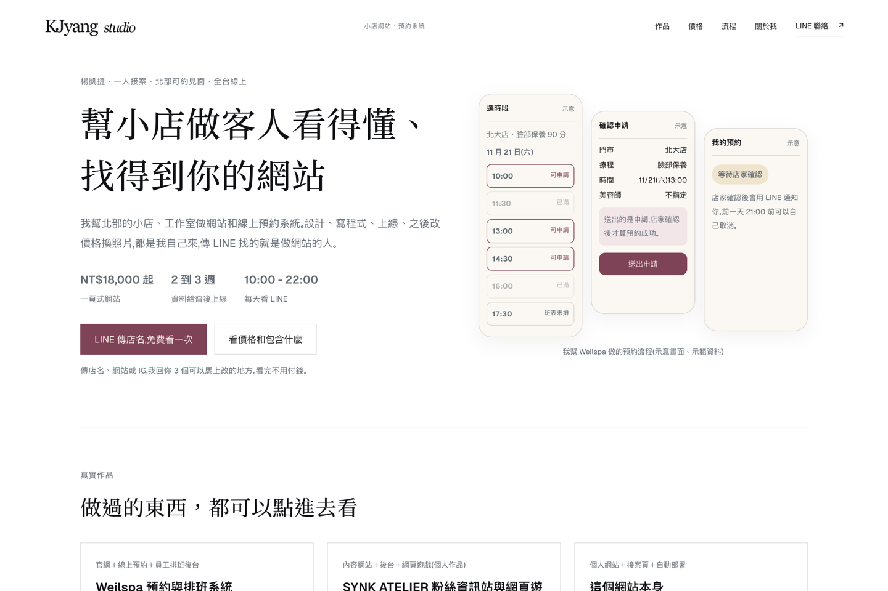

# KJyang Website / Studio

以 Astro 建立的個人網站，整合作品導覽、學習紀錄與 Studio 接案頁。

Studio 是楊凱捷一個人接案，幫小店做網站與預約系統。北部（雙北、桃園）可以約見面，其他地區主要線上進行。

- Website：[kjyang0114.dev](https://kjyang0114.dev/)
- Studio：[kjyang0114.dev/studio](https://kjyang0114.dev/studio/)

## 網站預覽

正式站桌面畫面，更新於 2026-10-05。

### 個人首頁

[](https://kjyang0114.dev/)

### KJyang Studio

[](https://kjyang0114.dev/studio/)

## 主要功能

- 個人作品集：10 個作品頁，另有履歷、Now、AI 筆記頁。
- Studio：服務、價格、流程、聯絡頁，6 篇文章，4 個產業範例網站（Demo library，不給搜尋引擎收錄）。
- Studio 有 3 個真實案例頁：Weilspa 預約與排班系統、SYNK ATELIER、這個網站本身。
- 文章由 14 篇整併成 6 篇，舊網址用 redirect 導向新頁面（對照表在 `astro.config.mjs`）。
- 中英文內容、SEO metadata、結構化資料、網站地圖與給 AI 讀的 llms.txt。
- Astro 靜態建置與 responsive layout。
- GitHub Actions、Docker 與自架主機部署流程。

## 專案結構

```text
src/pages/           網站路由
src/pages/studio/    Studio 頁面與 Demo
src/data/            服務、案例、文章與 SEO 結構化內容
src/components/      Navigation、layout、footer 與共用元件
public/              品牌、圖片與靜態產品檔案
scripts/             驗證、分享圖與 IndexNow 腳本
docs/                Studio 文案規範、SEO 整理紀錄
docker/              正式環境 nginx 設定
.github/workflows/   Build 與部署流程
```

## 核心程式

- [Studio 服務與方案資料](src/data/studio.ts)
- [Studio 真實案例資料](src/data/cases.ts)
- [Studio 文案規範](docs/studio-writing-guide.md)
- [SEO 整理紀錄](docs/seo-notes.md)
- [GitHub Actions 部署流程](.github/workflows/deploy-macmini.yml)
- [正式環境 Dockerfile](Dockerfile) 與 [nginx 設定](docker/nginx-site.conf)

## 實作重點

### 內容資料化

服務、流程、FAQ 與頁面 metadata 放在 `src/data`，避免相同資訊散落在多個 template，也讓不同頁面共用一致資料。

### 元件與版型

Navigation、shell、section、card 與 footer 使用共用 components。頁面保留自己的內容結構，不重複處理基礎 layout。

### 部署流程

推到 `main` 後，GitHub Actions 先安裝依賴並執行 build，再檢查部署環境變數，用 rsync 把原始碼同步到主機，由主機上的 `rebuild-docker.sh` 重建 Docker container。

正式環境是多階段 Dockerfile：第一階段用 node 執行 `npm run build`，第二階段用 nginx 送 `dist`，不再用 `astro preview` 當正式伺服器。容器聽 3000 埠，並提供 `/healthz`。主機上的看門狗會檢查這個網址，拿掉會報警。容器用 `--restart unless-stopped` 啟動。

`rebuild-docker.sh` 的順序：

1. 先把目前的鏡像標成 `previous`。
2. 先 build 新鏡像，build 失敗時舊容器還在服務。
3. build 成功後才停掉舊容器，用新鏡像啟動。
4. 等 `/healthz` 和首頁回 200，30 秒內沒通過就退回 `previous` 鏡像。

#### 部署的陷阱

`.gitignore` 是白名單：根目錄預設全部忽略，只有列出的檔案和資料夾會進 git。部署用 `rsync --delete`，主機上有、但 repo 裡沒有的檔案，下次部署會被刪掉。所以：

- 直接在主機上加、沒進 git 的檔案，下次部署會消失。
- 新增根目錄的檔案或資料夾，要同步加進 `.gitignore` 的白名單，否則不會進 git，也不會被部署。

## 本機執行

```bash
npm ci
npm run dev
npm run build
npm run preview
```

`npm run preview` 只用在本機預覽 build 的結果，正式環境由 nginx 提供。

### 驗證與工具指令

| 指令 | 做什麼 | 什麼時候跑 |
|---|---|---|
| `npm run verify:studio` | 先 build，再檢查 `/studio` 的頁面結構、站內連結、舊網址 redirect，並依 [文案規範](docs/studio-writing-guide.md) 擋下禁用寫法 | 改了 Studio 的文字或頁面之後 |
| `npm run verify:site` | 先 build，再檢查個人站路由、連結、資產、metadata、作品與 AI 主題完整性、sitemap | 改了個人站之後、部署前 |
| `npm run verify:seo` | 先 build，再檢查標題與說明長度、canonical、分享圖、結構化資料、sitemap、robots.txt、站內連結層數 | 改了 SEO 或頁面標題之後 |
| `npm run verify:motion` | 不開瀏覽器，檢查線稿動畫的幾何與生命週期 | 改了動畫之後 |
| `npm run og-images` | 產生分享用的 PNG（用 macOS 內建中文字型） | 改了價格或分享圖文字之後，要在 macOS 上跑 |
| `npm run indexnow` | 把網站地圖的網址送到 IndexNow，可加 `-- --dry-run` 先看清單 | 部署完成、線上內容和 `dist/` 一致之後 |

Docker：

```bash
docker compose up --build
```

`docker-compose.yml` 用同一份 Dockerfile 建置，埠也是 3000:3000，所以這個指令會在本機用 nginx 提供網站。compose 裡的 `HOST`、`PORT` 環境變數是舊的 `astro preview` 留下來的，nginx 不會讀。這條指令我沒有在本機實際跑過。

## 限制

- 部署需要主機、DNS、TLS 與 SSH secrets。
- Demo library 用於展示介面與操作流程，不連接正式客戶資料。
- 流量用 Cloudflare Web Analytics 量測，由 Cloudflare 自動插入，repo 裡沒有對應程式碼。
- `src/data/lastmod.mjs` 的網站地圖更新日期要手動維護：改了某頁的內容，就要更新這個檔案的日期。
- 三份 sitemap（`/sitemap.xml`、`/studio/sitemap.xml`、`/web-highlighter-pro/sitemap.xml`）、`robots.txt`、`llms.txt` 由 `src/data/discovery.ts` 等資料檔產生，改資料檔就好，不要直接改輸出。


## 個人網站重新設計（2026-09）

個人站採用 Human, then Code 視覺方向，淺深色自動跟隨系統。
Studio 與四個中文產業 Demo 另採暖色編輯式設計；產品頁與既有遊戲功能保留各自版型。

- `/`：個人定位、代表作品互動、網站服務入口。
- `/projects`：10 個作品的領域／語言篩選與可展開索引。
- `/projects/[slug]`：作品問題、實作、資料流程、目前範圍、GitHub。
- `/about`：學習與交付經歷、開發觀點、個人興趣。
- `/ai`：7 個 AI 入門主題與延伸閱讀。
- `/contact`：個人交流管道與 Studio 服務入口。

主要內容集中在 `src/data/projects.ts`，樣式位於 `src/styles/design-system.css`、`portfolio.css` 與 `exhibits.css`。
個人站元件放在 `src/components/portfolio/`，不與原 Studio 的外觀元件共用。
Three.js 模組於線稿接近可視範圍時載入；支援系統減少動態、暫停、離屏停止與 WebGL 失敗時的 SVG 替代。
2048 互動僅示範合併規則，不執行訓練模型。

```sh
npm ci
npm run dev -- --host 127.0.0.1 --port 4321
npm run verify:site
```

`verify:site` 先 build，再檢查個人站路由、連結、資產、metadata、作品與 AI 主題完整性及 sitemap。
舊設計提案存放於專案外的 `../design-archive/approved-proposals/`，不隨網站發布。
部署由 `main` 分支的 GitHub Actions 執行，細節見上方「部署流程」。

### Resume and motion

- `/resume`: complete engineering resume, section navigation, system appearance, and print / save-as-PDF stylesheet. Content lives in `src/data/resume.ts` and `src/pages/resume.astro`.
- Geometric art uses Three.js with an animated SVG fallback when WebGL cannot initialize. Both support pause, reduced-motion preferences, pointer response, and offscreen suspension.
- `npm run verify:motion` checks fallback animation and lifecycle without opening a browser. `npm run verify:site` builds and checks personal pages, including resume content and links.

### Now, playlists, and interactive linework

- `/now` contains manual updates and Spotify playlist embeds. The selected playlist is Daily; edit its public link and description in `src/data/now.ts`. No Spotify API keys or account tokens are used. There is no live listening status.
- The reusable `SpotifyPlaylist.astro` component accepts a public `https://open.spotify.com/playlist/<id>` URL, validates its host and ID, and renders Spotify's official iframe. Playback availability is controlled by Spotify. Liked Songs must first be copied into a shareable playlist; it is not automatically synchronized.
- `/play` provides ribbon, orbit, and wave shapes. Drag or use arrow keys to rotate; Home resets orientation. Both WebGL and SVG support shape changes, reduced motion, pause, and gradual return after dragging.
- Discord, Sift, and 2048 project pages include native expandable flow nodes. Descriptions distinguish implemented behavior from limitations instead of inventing incident histories.
- References: [Spotify embeds](https://developer.spotify.com/documentation/embeds/tutorials/creating-an-embed), [playlist visibility](https://support.spotify.com/article/playlist-privacy-and-access/).
