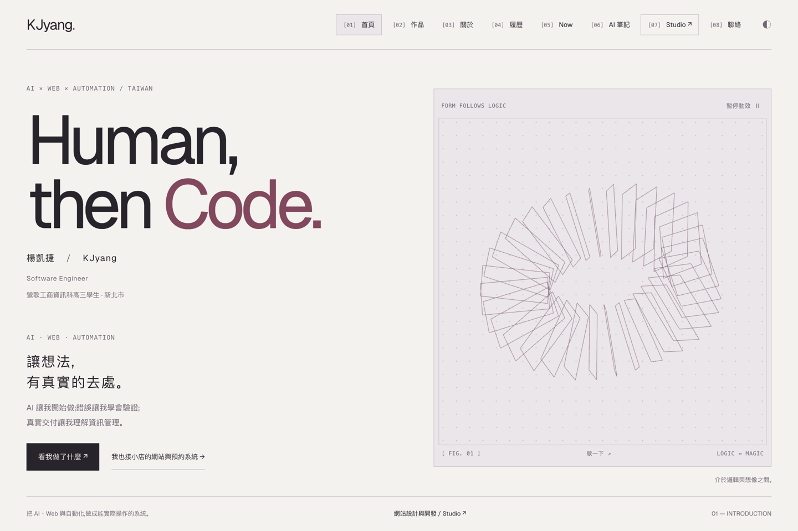

# KJyang Website / Studio

以 Astro 建立的個人網站，整合作品導覽、學習紀錄與 Studio 接案頁。

Studio 是楊凱捷一個人接案，幫小店做網站與預約系統。北部（雙北、桃園）可以約見面，其他地區主要線上進行。

- Website：[kjyang0114.dev](https://kjyang0114.dev/)
- Studio：[kjyang0114.dev/studio](https://kjyang0114.dev/studio/)

## 網站預覽

正式站桌面畫面，更新於 2026-11-16。

### 個人首頁

[](https://kjyang0114.dev/)

### KJyang Studio

[](https://kjyang0114.dev/studio/)

## 主要功能

- 個人作品集：10 個作品頁，另有履歷、Now、AI 筆記頁。SYNK ATELIER 是長版作品頁，有 8 張手機截圖，另有英文版 `/en/projects/synk-atelier`（非官方粉絲作品）。
- Studio：服務、價格、流程、聯絡頁，6 篇文章，4 個產業範例網站（Demo library，不給搜尋引擎收錄）。
- Studio 有 3 個真實案例頁：Weilspa 預約與排班系統、SYNK ATELIER、這個網站本身。
- 文章由 14 篇整併成 6 篇，舊網址用 redirect 導向新頁面（對照表在 `astro.config.mjs`）。
- 中英文內容、SEO metadata、結構化資料、網站地圖與給 AI 讀的 llms.txt。聯絡方式是 LINE ID 與 email。
- Astro 靜態建置與 responsive layout。
- GitHub Actions、Docker 與自架主機部署流程。

## 專案結構

```text
src/pages/           網站路由
src/pages/studio/    Studio 頁面與 Demo
src/pages/en/        英文履歷與英文作品頁
src/data/            服務、案例、文章與 SEO 結構化內容
src/components/      Navigation、layout、footer 與共用元件
public/              品牌、圖片與靜態產品檔案
scripts/             驗證、分享圖與 IndexNow 腳本
docs/                Studio 文案規範、SEO 整理紀錄
docker/              正式環境 nginx 設定
deploy/ci-runner/    CI runner 容器的 image（Mac mini）
.github/workflows/   檢查、審查與部署流程
```

## 核心程式

- [Studio 服務與方案資料](src/data/studio.ts)
- [Studio 真實案例資料](src/data/cases.ts)
- [Studio 文案規範](docs/studio-writing-guide.md)
- [SEO 整理紀錄](docs/seo-notes.md)
- [GitHub Actions 部署流程](.github/workflows/deploy-macmini.yml)
- [正式環境 Dockerfile](Dockerfile) 與 [nginx 設定](docker/nginx-site.conf)

## 實作重點

### 內容資料化

服務、流程、FAQ 與頁面 metadata 放在 `src/data`，避免相同資訊散落在多個 template，也讓不同頁面共用一致資料。

### 元件與版型

Navigation、shell、section、card 與 footer 使用共用 components。頁面保留自己的內容結構，不重複處理基礎 layout。

### 部署流程

所有 GitHub Actions 工作都跑在 Mac mini 上的兩個 runner 容器，不用 GitHub 代管機器（見下方「CI runner」）。

開 PR 時，`.github/workflows/ci-gate.yml` 會跑 `npm ci`、`npm run check`，再用 `npm run verify:runtime -- --nginx` 以 runner 裡的 nginx 載入 `docker/nginx-site.conf` 送剛 build 好的 `dist/`，檢查路由與標頭。runner 裡沒有 Docker，所以 PR 上不再 `docker build`；Dockerfile 本身要到部署時才由主機上的 `rebuild-docker.sh` 建置並做健康檢查（失敗自動退回）。同一個 PR 再 push 時，舊的檢查會被取消。fork 的 PR 不跑任何工作。PR 和其他分支不會部署。

`.github/workflows/claude-gate.yml` 會在 PR 上跑 Claude 的自動審查（官方 code-review plugin，以 Claude GitHub App 身分留言，只用 repo secret `CLAUDE_CODE_OAUTH_TOKEN`），審查沒有問題、`ci-gate` 通過、作者是站長或 Claude App 時自動 rebase 合併，接著觸發部署。審查有問題推播「審查沒過」；作者不符、Claude App 改了 `.github/`、審查略過或沒跑完，留言並推播「等你合併」。draft PR 不審查、不合併。沒設 `CLAUDE_CODE_OAUTH_TOKEN` 時這個流程什麼都不做。

推到 `main` 後，`.github/workflows/deploy-macmini.yml` 先呼叫同一份 `ci-gate`，檢查通過才部署：用 rsync 把原始碼同步到主機，再由主機上的 `rebuild-docker.sh` 重建 Docker container。檢查沒過就不部署。部署一次只跑一個，新的 push 會排在後面，不會把進行中的部署砍掉。claude-gate 用 `GITHUB_TOKEN` 合併時 GitHub 不會產生 push 事件，所以合併後由 `.github/scripts/claude-gate-decide.sh` 以 `workflow_dispatch` 在 `main` 上觸發同一個部署流程（一樣先跑 `ci-gate`）。

手動跑 Deploy to Mac mini 時勾 `dry_run`（任何分支都可以）只做 SSH 連線測試與 `rsync --dry-run`，不檢查、不同步、不重建，用來確認 runner 連得到主機。

正式環境是多階段 Dockerfile：第一階段用 node 22 執行 `npm ci` 和 `npm run build`，第二階段用 nginx 送 `dist`，不再用 `astro preview` 當正式伺服器。容器聽 3000 埠，並提供 `/healthz`。主機上的看門狗會檢查這個網址，拿掉會報警。容器用 `--restart unless-stopped` 啟動。

`rebuild-docker.sh` 的順序：

1. 把正在跑的容器實際使用的映像標成 `previous`（沒有容器時才用 `:latest`）。
2. 先 build 新鏡像，build 失敗時舊容器還在服務。
3. build 成功後才停掉舊容器，用新鏡像啟動（最多試三次）。
4. 等 `/healthz` 和首頁回 200，30 秒內沒通過、或新容器起不來，就退回 `previous` 鏡像，再做一次健康檢查。

結束碼：

| 碼 | 意思 |
|---|---|
| `0` | 部署成功 |
| `10` | 新鏡像沒建起來，舊容器沒動 |
| `20` | 新版不能用，已退回上一版，退回後健康檢查通過 |
| `30` | 退回也失敗、沒有可退回的鏡像，或 3000 埠被別的程序占著；網站可能停擺 |

`npm run test:rebuild` 用假的 `docker`、`curl` 跑過這幾種情況，`npm run check` 會一起跑。真的退回流程沒有在主機上演練過。

`main` 的檢查失敗、部署失敗、或自動退回時，workflow 會用 ntfy 推播到手機（頻道名稱存在 repo secret `NTFY_TOPIC`，沒設就不發）。部署成功和 PR 上的檢查失敗不發。

#### 部署的陷阱

`.gitignore` 是白名單：根目錄預設全部忽略，只有列出的檔案和資料夾會進 git。部署用 `rsync --delete`，主機上有、但 repo 裡沒有的檔案，下次部署會被刪掉。所以：

- 直接在主機上加、沒進 git 的檔案，下次部署會消失。
- 新增根目錄的檔案或資料夾，要同步加進 `.gitignore` 的白名單，否則不會進 git，也不會被部署。

### CI runner

架構與防火牆、清理 hook、`run-container.sh`、`register.sh` 都沿用 synk-atelier 的範本（那個 repo 的 `deploy/ci-runner/` 與 `docs/OPS-PIPELINE.md`「CI runner」一節）。這裡只有 `deploy/ci-runner/Dockerfile`：以 Mac mini 上的 `synk-ci-runner:latest` 為基底，加裝 rsync、nginx 與 Node 22，建成 `astro-web-ci-runner:latest`。

| runner（容器名） | 標籤 | 跑什麼 | 上限 |
|---|---|---|---|
| `astro-web-ci-build` | `self-hosted, astro-web-ci, astro-web-ci-build` | `ci-gate`（會跑 PR 的程式碼，不拿 secret） | 2 CPU、1.5 GB（含 swap）、shm 64 MB |
| `astro-web-ci-gate` | `self-hosted, astro-web-ci, astro-web-ci-gate` | 部署、dry-run、通知、claude-gate 的審查與合併（不跑 repo 的程式碼） | 1 CPU、768 MB（含 swap）、shm 64 MB |

規則：
- `runs-on` 一律寫滿三個標籤，不能只寫 self-hosted 這一個標籤，也不能改回 GitHub 代管的機器。檢查：`grep -n "runs-on" .github/workflows/*.yml` 每一行都要有 `astro-web-ci-build` 或 `astro-web-ci-gate`。
- 容器不掛 Docker socket、不掛主機路徑，只有具名 volume `<容器名>-runner`；網路是自己的 `astro-web-ci-net`。entrypoint 擋掉主機與所有私有網段（含 Tailscale 的 100.64/10），之後以 uid 1100 的 `runner`、沒有 capability 跑。工作裡沒有 Docker、沒有 sudo。
- 部署要從容器 SSH 到主機：`MACMINI_HOST` 若是區網或 Tailscale 位址會被防火牆擋，先用 `dry_run` 測。
- 這是公開 repo：fork 的 PR 會帶自己的 workflow 檔，`runs-on` 與 job 的 `if` 都擋不住。防線是 repo 設定 Settings → Actions → General 的「fork PR 的 workflow 要核准」，建議設成所有外部貢獻者都要核准。

以下指令在 Mac mini 上以 kjyang 身分執行（不用 sudo），先 `export PATH=/Applications/Docker.app/Contents/Resources/bin:$PATH`。

建 image（`~/astro-web-ci-runner-build/` 放這份 Dockerfile；`synk-ci-runner:latest` 重建後這裡也要重建）：

```sh
docker build -t astro-web-ci-runner:latest ~/astro-web-ci-runner-build
```

建容器（`run-container.sh` 是 synk-atelier 範本的那一份，Mac mini 上在 `~/synk-ci-runner-build/`；已存在的同名容器不會被動到）：

```sh
NAME=astro-web-ci-build CPUS=2 MEMORY=1536m SHM=64m NETWORK=astro-web-ci-net IMAGE=astro-web-ci-runner:latest bash ~/synk-ci-runner-build/run-container.sh
NAME=astro-web-ci-gate CPUS=1 MEMORY=768m SHM=64m NETWORK=astro-web-ci-net IMAGE=astro-web-ci-runner:latest bash ~/synk-ci-runner-build/run-container.sh
```

註冊、重新註冊（在已登入 `gh` 的筆電上跑；註冊碼經 ssh 的 stdin 進容器，不會出現在畫面或指令列；`--replace` 會沿用同名的舊登記，所以重新註冊是同一行）：

```sh
for r in astro-web-ci-build:astro-web-ci,astro-web-ci-build astro-web-ci-gate:astro-web-ci,astro-web-ci-gate; do gh api -X POST repos/KJyang-0114/astro-web/actions/runners/registration-token -q .token | ssh -o BatchMode=yes <Mac mini> "/Applications/Docker.app/Contents/Resources/bin/docker exec -i ${r%%:*} /usr/local/lib/ci-runner/register.sh KJyang-0114/astro-web ${r%%:*} ${r#*:}"; done
gh api repos/KJyang-0114/astro-web/actions/runners --jq '.runners[] | "\(.name) \(.status) \([.labels[].name] | join(","))"'
```

改上限（不用重建）：`docker update --cpus N --memory Xg --memory-swap Xg astro-web-ci-build`。

image 更新後重建容器（volume 留著，不用重新註冊）：`docker rm -f astro-web-ci-build`，再跑上面的建容器指令。

拆掉：先在 GitHub 刪 runner（Settings → Actions → Runners），再 `docker rm -f astro-web-ci-build astro-web-ci-gate && docker volume rm astro-web-ci-build-runner astro-web-ci-gate-runner && docker network rm astro-web-ci-net`。

量測（2026-11-20，`astro-web-ci-build` 註冊前以 runner 身分試跑兩次，同時 synk-ci-build 也在跑工作）：`npm ci` 9–14 秒、`npm run check` 19–26 秒、`verify:runtime -- --nginx` 1 秒以內；匿名記憶體尖峰 532 MB（每 0.5 秒取樣），另有約 370 MB 頁快取，1 GB 時常頂到上限回收、沒有 OOM。註冊後 runner 本身還要約 150–300 MB，所以起始上限從 1 GB 調到 1.5 GB。CPU 吃滿 2 核。試跑期間正式站 `/healthz` 全部 200。

## 本機執行

```bash
npm ci
npm run dev
npm run build
npm run preview
```

`npm run preview` 只用在本機預覽 build 的結果，正式環境由 nginx 提供。

### 驗證與工具指令

| 指令 | 做什麼 | 什麼時候跑 |
|---|---|---|
| `npm run check:fast` | 只檢查這次改到的檔案（`git diff HEAD` 加未追蹤檔）：lint、需要時型別檢查與 build、對應的驗證腳本 | 改完程式先跑這個 |
| `npm run check` | 完整檢查：lint、`astro check`、build、六支驗證腳本、`rebuild-docker.sh` 的假指令測試。CI 跑的就是這個 | 開 PR 前 |
| `npm run verify:runtime` | 用 Dockerfile 建映像，在本機起測試容器，打 `/healthz`、sitemap 的每個路由、轉址、404、Content-Type、快取標頭。只連 127.0.0.1，要先開 Docker。加 `-- --nginx` 改用本機的 nginx 載入 `docker/nginx-site.conf` 送現有的 `dist/`，不用 Docker（CI 跑這個） | 改了 Dockerfile、nginx 設定或路由之後 |
| `npm run test:rebuild` | 用假的 `docker`、`curl` 測 `rebuild-docker.sh` 各種情況的結束碼與指令順序，不碰真的 Docker | 改了 `rebuild-docker.sh` 之後 |
| `npm run verify:studio` | 先 build，再檢查 `/studio` 的頁面結構、站內連結、舊網址 redirect，並依 [文案規範](docs/studio-writing-guide.md) 擋下禁用寫法 | 改了 Studio 的文字或頁面之後 |
| `npm run verify:site` | 先 build，再檢查個人站路由、連結、資產、metadata、作品與 AI 主題完整性、sitemap，以及英文作品頁的 lang、canonical、hreflang 與語言切換連結 | 改了個人站之後、部署前 |
| `npm run verify:seo` | 先 build，再檢查標題與說明長度、canonical、分享圖、結構化資料、sitemap、robots.txt、站內連結層數 | 改了 SEO 或頁面標題之後 |
| `npm run verify:motion` | 不開瀏覽器，檢查線稿動畫的幾何與生命週期 | 改了動畫之後 |
| `npm run og-images` | 產生分享用的 PNG（用 macOS 內建中文字型） | 改了價格或分享圖文字之後，要在 macOS 上跑 |
| `npm run indexnow` | 把網站地圖的網址送到 IndexNow，可加 `-- --dry-run` 先看清單 | 部署完成、線上內容和 `dist/` 一致之後 |

Docker：

```bash
docker compose up --build
```

`docker-compose.yml` 用同一份 Dockerfile 建置，埠也是 3000:3000，所以這個指令會在本機用 nginx 提供網站。compose 裡的 `HOST`、`PORT` 環境變數是舊的 `astro preview` 留下來的，nginx 不會讀。這條指令我沒有在本機實際跑過。

## 限制

- 部署需要主機、DNS、TLS 與 SSH secrets。
- Demo library 用於展示介面與操作流程，不連接正式客戶資料。
- 流量用 Cloudflare Web Analytics 量測，由 Cloudflare 自動插入，repo 裡沒有對應程式碼。
- `src/data/lastmod.mjs` 的網站地圖更新日期要手動維護：改了某頁的內容，就要更新這個檔案的日期。
- 三份 sitemap（`/sitemap.xml`、`/studio/sitemap.xml`、`/web-highlighter-pro/sitemap.xml`）、`robots.txt`、`llms.txt` 由 `src/data/discovery.ts` 等資料檔產生，改資料檔就好，不要直接改輸出。


## 個人網站重新設計（2026-09）

個人站採用 Human, then Code 視覺方向，淺深色自動跟隨系統。
Studio 與四個中文產業 Demo 另採暖色編輯式設計；產品頁與既有遊戲功能保留各自版型。

- `/`：個人定位、代表作品互動、網站服務入口。
- `/projects`：10 個作品的領域／語言篩選與可展開索引。
- `/projects/[slug]`：作品問題、實作、資料流程、目前範圍、GitHub。有 `sections` 欄位的作品（目前是 SYNK ATELIER）改用 `ProjectStory.astro` 渲染成長版頁面，截圖放 `public/projects/<slug>/`，在 `gallery` 欄位列出。
- `/about`：學習與交付經歷、開發觀點、個人興趣。
- `/ai`：7 個 AI 入門主題與延伸閱讀。
- `/contact`：個人交流管道與 Studio 服務入口。
- `/en/projects/[slug]`：作品的英文版，目前只有 SYNK ATELIER。要替另一個作品加英文版，在 `src/data/projects.ts` 該作品的 `en` 欄位填英文標題、說明、`sections` 和 `gallery`（作品本身要有 `sections`），路由 `src/pages/en/projects/[slug].astro` 會自動產生頁面，網站地圖和 llms 清單也會帶上。中英文頁用 hreflang 互相指向，頁面有語言切換連結。新頁面要在 `src/data/lastmod.mjs` 補日期，並在 `scripts/verify-site.mjs` 加檢查。

主要內容集中在 `src/data/projects.ts`，樣式位於 `src/styles/design-system.css`、`portfolio.css` 與 `exhibits.css`。
個人站元件放在 `src/components/portfolio/`，不與原 Studio 的外觀元件共用。
Three.js 模組於線稿接近可視範圍時載入；支援系統減少動態、暫停、離屏停止與 WebGL 失敗時的 SVG 替代。
2048 互動僅示範合併規則，不執行訓練模型。

```sh
npm ci
npm run dev -- --host 127.0.0.1 --port 4321
npm run verify:site
```

`verify:site` 先 build，再檢查個人站路由、連結、資產、metadata、作品與 AI 主題完整性及 sitemap。
舊設計提案存放於專案外的 `../design-archive/approved-proposals/`，不隨網站發布。
部署由 `main` 分支的 GitHub Actions 執行，細節見上方「部署流程」。

### Resume and motion

- `/resume`: complete engineering resume, section navigation, system appearance, and print / save-as-PDF stylesheet. Content lives in `src/data/resume.ts` and `src/pages/resume.astro`.
- Geometric art uses Three.js with an animated SVG fallback when WebGL cannot initialize. Both support pause, reduced-motion preferences, pointer response, and offscreen suspension.
- `npm run verify:motion` checks fallback animation and lifecycle without opening a browser. `npm run verify:site` builds and checks personal pages, including resume content and links.

### Now, playlists, and interactive linework

- `/now` contains manual updates and Spotify playlist embeds. The selected playlist is Daily; edit its public link and description in `src/data/now.ts`. No Spotify API keys or account tokens are used. There is no live listening status.
- The reusable `SpotifyPlaylist.astro` component accepts a public `https://open.spotify.com/playlist/<id>` URL, validates its host and ID, and renders Spotify's official iframe. Playback availability is controlled by Spotify. Liked Songs must first be copied into a shareable playlist; it is not automatically synchronized.
- `/play` provides ribbon, orbit, and wave shapes. Drag or use arrow keys to rotate; Home resets orientation. Both WebGL and SVG support shape changes, reduced motion, pause, and gradual return after dragging.
- Discord, Sift, and 2048 project pages include native expandable flow nodes. Descriptions distinguish implemented behavior from limitations instead of inventing incident histories.
- References: [Spotify embeds](https://developer.spotify.com/documentation/embeds/tutorials/creating-an-embed), [playlist visibility](https://support.spotify.com/article/playlist-privacy-and-access/).
